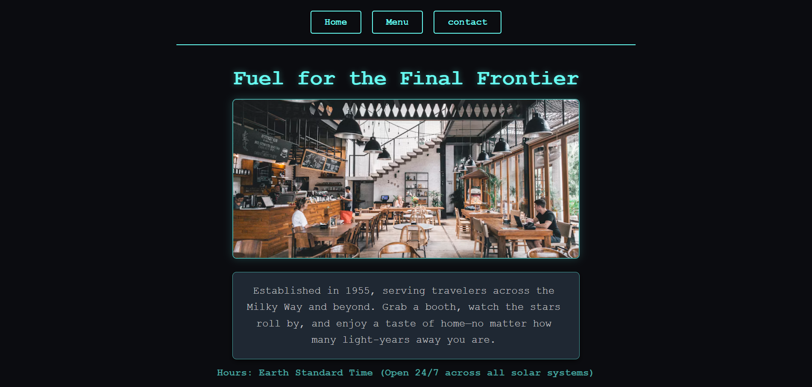

# 🛸🌌 Odin Cosmic Cafe

A sleek, interactive, and responsive Single Page Application (SPA) built as part of The Odin Project curriculum. This project focuses heavily on modern frontend tooling with Webpack, modular JavaScript architecture using ES6 import/export syntax, and dynamic DOM manipulation—all wrapped in a 1950s retro-futuristic space diner theme.

<p align="center">
  
</p>

---

## ✨ Features

- **Modular SPA Architecture:** Built completely from scratch using vanilla JavaScript components (`home.js`, `menu.js`, `contact.js`) dynamically rendered into a central container.
- **Persistent Header & Tab-Switching:** Features a persistent navigation header that stays locked in place while content views switch instantly without full page reloads.
- **Webpack Bundling & Dev Server:** Configured with Webpack 5, `html-webpack-plugin`, style/css loaders, and live-reloading development server (`webpack serve`).
- **Retro-Futuristic Space Theme UI:** Styled with deep-space dark aesthetics, glowing neon accents, responsive card grids, and high-fidelity culinary space imagery.

---

## 🎨 UI Architecture & Blueprint

The interface utilizes a persistent navigation bar coupled with a dynamic content viewport:

```
+-----------------------------------------------------------------------+
|                       COSMIC CAFE DINER                               |
|            [ Home ]         [ Menu ]         [ Contact ]              |
|-----------------------------------------------------------------------+
|                                                                       |
|                          [ Hero / Content ]                           |
|      +---------------------------------------------------------+      |
|      |               Fuel for the Final Frontier               |      |
|      |       [ Neon Space Diner Interior Image / Cards ]       |      |
|      |    Welcome to The Cosmic Cafe! Step into our retro-     |      |
|      |    futuristic space diner where the milkshakes are      |      |
|      |    stellar and burgers are completely out of this world.|      |
|      +---------------------------------------------------------+      |
|                                                                       |
+-----------------------------------------------------------------------+
```

---

## 🚀 Live Demo

[👉 Click here to view the live deployment of the Cosmic Cafe App!](https://villa116.github.io/odin-restaurant-page/)

---

## 🛠️ Technical Deep Dive

### ES6 Module Architecture

The application separates concerns by exporting dedicated DOM-creation functions from isolated JavaScript modules, keeping `index.js` clean and focused solely on layout assembly and event routing.

```
// src/home.js
const createHomeTab = () => {
  const homeDiv = document.createElement('div');
  homeDiv.classList.add('home-content');

  const headline = document.createElement('h1');
  headline.textContent = 'Fuel for the Final Frontier';

  const card = document.createElement('div');
  card.classList.add('hero-card');
  
  const description = document.createElement('p');
  description.textContent = 'Welcome to The Cosmic Cafe! Step into our retro-futuristic space diner...';

  card.appendChild(description);
  homeDiv.appendChild(headline);
  homeDiv.appendChild(card);

  return homeDiv;
};

export default createHomeTab;
```

---

## 🧱 CSS Styling & Neon Aesthetics

Custom color schemes, card layouts, and hover transitions build out the retro space atmosphere.

```
body {
  font-family: 'Courier New', Courier, monospace;
  background-color: #0b0c10;
  color: #c5c6c7;
  min-height: 100vh;
  display: flex;
  flex-direction: column;
  align-items: center;
}

.nav-btn {
  background-color: transparent;
  color: #66fcf1;
  border: 2px solid #66fcf1;
  padding: 10px 25px;
  cursor: pointer;
  transition: all 0.3s ease;
}

.nav-btn:hover {
  background-color: #66fcf1;
  color: #0b0c10;
  box-shadow: 0 0 15px #66fcf1;
}
```

---

## 📁 File Structure

```
odin-restaurant-page/
├── dist/                  # Production-ready compiled bundle output
├── src/
│   ├── contact.js         # Contact Mission Control module view
│   ├── home.js            # Home hero landing module view
│   ├── index.js           # Main application entry point & event router
│   ├── menu.js            # Out-of-this-world menu items module view
│   ├── style.css          # Retro space diner styles and responsive rulesets
│   └── template.html      # HTML skeleton template for HtmlWebpackPlugin
├── package.json           # Dependencies and project configurations
├── webpack.config.js      # Webpack development and build configuration
└── odin-restaurant-Preview.png# Project workspace preview capture resource
```

---

## 💻 Installation & Usage

1. Clone the repo
```
git clone https://github.com/Villa116/odin-restaurant-page.git
```

2. Enter the folder
```
cd odin-restaurant-page
```

3. Install dependencies
```
npm install
```

4. Run the development server
```
npx webpack serve
```

---

## 🧪 Technologies Used

- **HTML5:** Dynamic DOM element creation and semantic container structuring.
- **CSS3:** Flexbox layouts, CSS variables, glowing box-shadows, and responsive media queries.
- **JavaScript (ES6+):** ES modules (import/export), arrow functions, event listeners, and DOM manipulation.
- **Webpack 5:** Asset bundling, source mapping, `html-webpack-plugin`, style/css loaders, and live-reloading dev server.

---

## 🌟 Future Enhancements

- **Online Reservations Form:** Allow earthlings and galactic travelers to book booth space across solar sectors.
- **Interactive Cart & Ordering:** Add items from the menu into a live order tray with subtotal calculations.
- **Retro Sci-Fi Sound Effects:** Integrate audio toggles for button clicks and warp-speed tab transitions.

Developed with ❤️ by Villa Bukasa